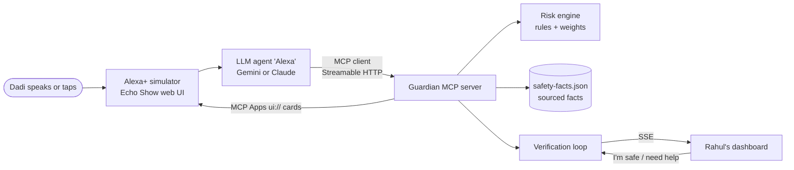

# Guardian

**An Alexa+ safety layer that stops "digital arrest" scams, built as a self-hosted MCP server.**

In a "digital arrest" scam, someone posing as CBI, ED or police keeps an elderly person on a video call, says they
are under arrest, tells them to keep it secret, and makes them transfer money. There is no such thing as a digital
arrest in Indian law. Guardian lets Alexa+ recognise the pattern from what the user says, explain it calmly in their
language, alert their family, and check with a trusted family member before any money moves. The same engine
catches related impersonation scams: fake RBI "safe account", courier/narcotics parcel, the US grandparent
voice-clone call and IRS/FBI impersonation.

Demo persona: **Dadi**, who lives alone in Lucknow and mixes Hindi, Hinglish and English. Her grandson **Rahul**
lives in Bengaluru and gets the alerts.

> Built for the Amazon "Build, Ship, Shape" hackathon, Alexa+ track.
> Live demo: simulator [guardian-simulator.onrender.com](https://guardian-simulator.onrender.com/) · family dashboard [guardian-server-mt1b.onrender.com/dashboard](https://guardian-server-mt1b.onrender.com/dashboard/) · MCP endpoint `https://guardian-server-mt1b.onrender.com/mcp`
> (Free hosting: the first request after idle can take up to a minute while the services wake up.)

## How it works



1. Dadi describes the call ("ek CBI officer video call pe hai, digital arrest bol raha hai, kisi ko batana mat…").
2. The Alexa+ agent calls `assess_scam_risk`. The deterministic engine returns a 0–100 score, the scam pattern,
   and every red flag with the exact phrase that triggered it.
3. If the risk is high, Alexa speaks verified guidance (`get_safety_guidance`), alerts the family
   (`notify_family`), and asks Rahul on his own phone (`verify_with_family`).
4. Rahul taps **No case — it's a scam**. `check_verification` flips to `confirmed_safe`, and Alexa tells Dadi to
   end the call and report it at 1930.
5. The risk score and the verification result render on the Echo Show as **MCP Apps** cards (`ui://` resources).

## MCP server

| | |
|---|---|
| Transport | Streamable HTTP, `POST /mcp`, stateless (a new server and transport per request) |
| MCP spec | Negotiates **2025-11-25** (the SDK also supports 2026-07-28); asserted in `packages/server/test/mcp.test.ts` |
| SDK | MCP TypeScript SDK v2: `@modelcontextprotocol/server`, `/node`, `/express`, `/client`; zod v4 |
| MCP Apps | `@modelcontextprotocol/ext-apps`: `ui://guardian/risk-card`, `ui://guardian/verified-card` |

| Tool | What it does |
|---|---|
| `assess_scam_risk` | Scores the situation the user describes. Returns score, band, typology, flags with evidence, recommended action. Renders the risk card. |
| `get_safety_guidance` | 2–3 facts with source URLs, next steps, and a short reply to speak in the user's language. |
| `notify_family` | Sends a one-line alert (never a transcript) to the family dashboard. |
| `get_household_context` | The user's name, language and trusted contacts. Phone numbers are never returned. |
| `verify_with_family` | Asks the primary trusted contact, on their own phone, whether the claim is real. |
| `check_verification` | `pending`, `confirmed_safe`, `needs_help` or `no_response` (after 90 s), with a line to speak. Renders the verification card. |

The server also sends MCP `instructions` telling the assistant to call `assess_scam_risk` first, then guidance,
alert and verification when the risk is high. Details: [`packages/server/README.md`](packages/server/README.md).

## Risk engine

Pure TypeScript, no dependencies, no LLM: the same input always gives the same score, and every score explains
itself. 11 red flags with phrase lists in English, romanized Hinglish and Devanagari Hindi; 5 scam typologies.

```
base       = sum of weights of the flags that fired      (max single weight 20)
confidence = 0.6 + 0.4 × (supporting flags present / supporting flags defined)   (0 if no typology)
score      = min(100, base + round(25 × confidence))
bands      = low < 25 ≤ medium < 55 ≤ high < 80 ≤ critical
```

One alarming word ("police", "CBI", "jail") can never raise an alert on its own. Test results on 39 labelled
cases: **24/24 scams caught, 0/15 benign look-alikes flagged** (e.g. "I watched a CBI movie on TV",
"the courier delivered my medicines"). Details: [`packages/risk-engine/README.md`](packages/risk-engine/README.md).

## Run it locally

Requires Node 20+ and a Gemini API key (free tier works) or an Anthropic API key.

```sh
npm install
cp .env.example .env          # then put your GEMINI_API_KEY in .env
npm run dev:server            # Guardian MCP server: http://localhost:3000/mcp, dashboard at /dashboard/
npm run dev:simulator         # Alexa+ simulator:   http://localhost:5173
```

Open the simulator and Rahul's dashboard side by side, then use the **Digital arrest**, **Grandson** and
**Benign** presets. The full script is in [`packages/simulator/DEMO.md`](packages/simulator/DEMO.md).

Other commands:

```sh
npm test                            # 63 tests: 43 risk engine, 20 server (MCP over Streamable HTTP)
npm run build
npm run inspect -w @guardian/server # MCP Inspector; connect to http://localhost:3000/mcp, transport Streamable HTTP
claude mcp add --transport http guardian http://localhost:3000/mcp   # use Guardian from Claude Code
```

Deploy: [`render.yaml`](render.yaml) creates both services on Render. Set `GEMINI_API_KEY` and, after the server is
live, `GUARDIAN_MCP_URL=https://<server>/mcp` on the simulator. Render adds a suffix to the server URL if the name is taken (ours is `guardian-server-mt1b`), so copy the exact URL.

## Repository

```
packages/risk-engine   scam typology engine (pure TS) + tests
packages/server        Guardian MCP server, MCP Apps cards, family dashboard, events API
packages/simulator     Alexa+ simulator: MCP client + LLM agent backend, Echo Show web UI
data/                  household.json (persona, contacts), safety-facts.json (facts + source URLs)
docs/                  friction-log.md, feedback.md, video-script.md
```

## Dignity and privacy by design

- **No call recording.** Guardian only sees what the user chooses to tell Alexa.
- **Family sees summaries, never transcripts.** Alerts are one line written for Rahul.
- **Phone numbers stay on the server.** The LLM gets names and relationships only.
- **Dadi stays in control.** Calm, short replies that never shame her. *Ask silently* mode shows the reply on screen
  instead of speaking it, for when the "officer" is watching on video.
- **Truthful.** Spoken safety facts come word for word from `data/safety-facts.json`, each with a source URL.

## Limitations

- **Simulator, not a real Echo device.** The Alexa+ experience is simulated in a browser (Web Speech API + an LLM
  agent acting as Alexa) because we did not have access to connect an MCP server to Alexa+ on a device. The
  MCP server itself is host-agnostic and works with any MCP client.
- **Guardian doesn't listen to calls.** It works from what the user tells Alexa during or after the call.
- **Rules, not ML.** New wording outside the lexicons is missed; negation isn't understood. The LLM decides when
  to call the tools: server instructions make this likely, not guaranteed.
- **No authentication** on `/mcp` or the family respond endpoint, and the family channel is the web dashboard, not
  SMS/WhatsApp. State is in memory plus a JSON file, so it resets on redeploy.
- **Fact verification is in progress:** facts in `data/safety-facts.json` marked `"verified": false` still need a
  human check against their source.

## What's next

Real Alexa+ integration through the MCP toolkit once it's open, an SMS/WhatsApp channel for family, more Indian
languages, a family code-word check for voice-clone calls, and publishing the risk engine as a standalone
open-source package.

## License

[MIT](LICENSE)
